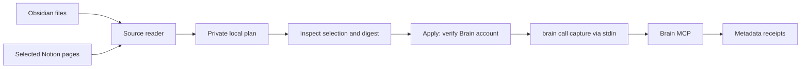

# How it works

The adapter's only contract is `Iterable[Record]`. Shared code validates IDs and scope, enforces
batch limits and writes one local JSON snapshot. `apply` loads and validates the entire bounded
plan before any writes, checks its SHA-256, checks the current firm/user IDs through
`configure(account={})`, then calls `capture` sequentially. No assistant processes the source text.

We use text capture because Brain supports versions of documents under a stable system/record ID.
Using `brain upload` would preserve original file bytes but its IDs identify additive snapshots.
For these text sources, capture makes repeat imports clearer. The importer sets no entities,
facts, relationships or instructions; Brain retains responsibility for its own processing.

No local 'already imported' database is needed. Reruns send the same IDs to Brain, which handles
unchanged text. This avoids a stale checkpoint silently skipping data for a different account.
The trade-off is a CLI subprocess and MCP call per record, including unchanged records. This
starter favors understandable batches over a long-lived session or optimized background sync.
Use current plans in chronological order; an old plan can create another version of old text.
Metadata-only changes may be treated as unchanged by Brain's text deduplication.

Selection changes and upstream deletions do not remove anything from Brain. Changing scope doesn't
reshare existing sources. Previous records' scope is retained by the server, and a mismatch or
warning stops the run after recording that response. A failed batch isn't rolled back. Receipt
files are flushed after each success. A crash between a remote success and a local receipt leaves
an uncertain result; rerun with the same source identity and review the returned source ID.

Plans are bounded at 32 MiB, records default to 500 KB text, and batches default to 500 records
(the real config example starts at 50). Raise text limits only intentionally; the configurable
ceiling is 2 MB and 5,000 records. For larger collections select subfolders or subsets of page IDs.
This avoids an unbounded initial import and makes plans practical to review.

Local files are created exclusively with owner-only permissions on POSIX (directories created as
0700, files as 0600). On Windows use a private user directory and appropriate filesystem ACLs.
Outputs are ignored by Git, not encrypted; manage retention and backups locally. Plans are local
code inputs, not an authenticated approval system. Inspect a plan before confirming its digest.

Brain responses and subprocess diagnostics can contain private material, so only an allowlist of
receipt fields reaches disk/output. A failed command deliberately reports a short generic error;
if diagnosis requires raw results, inspect them privately and don't attach them to an issue.
The server URL comes from configuration, not source text, and is passed explicitly to the CLI.
Credentials remain in the CLI's existing keyring. Don't switch or log out that profile mid-run.

Contract baseline: Alludium Brain CLI 0.29.100, `capture` fields documented in this repository,
`configure(account={})` identity. Use `brain tools` privately to inspect live schemas when extending.
Offline tests prove mapping and transport behavior, not hosted authentication or provider coverage.
